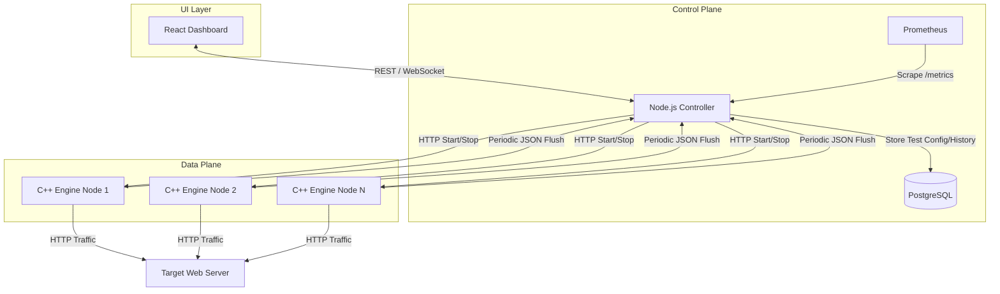
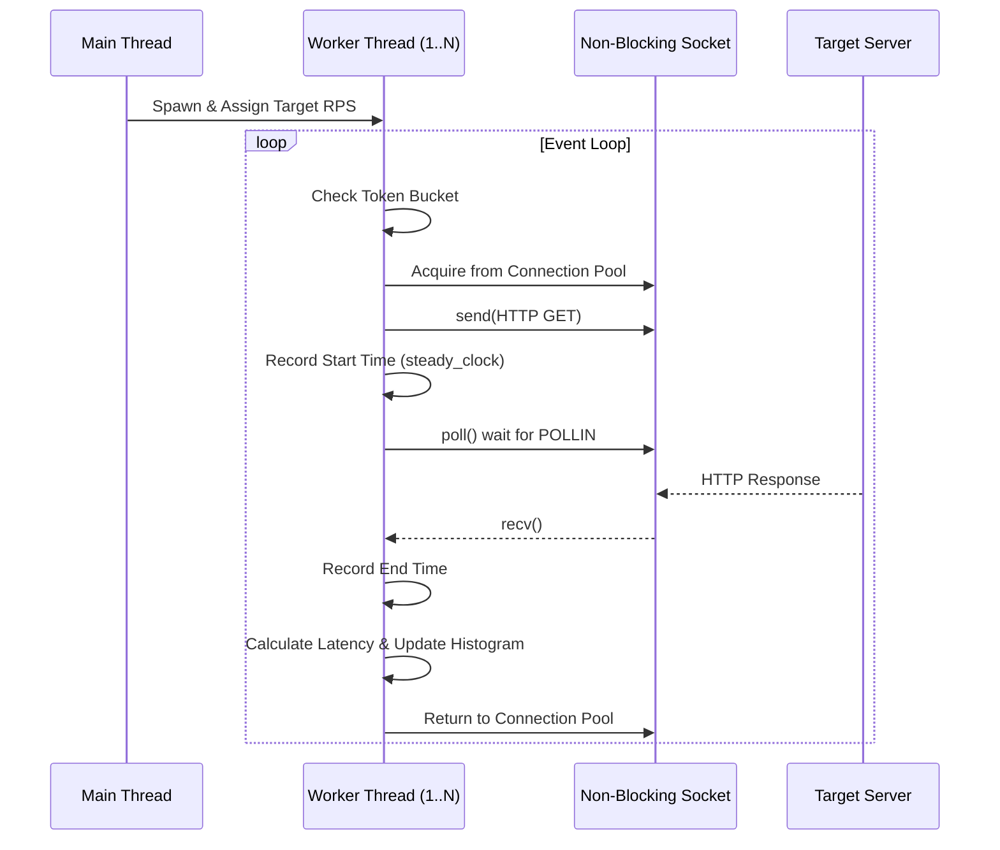
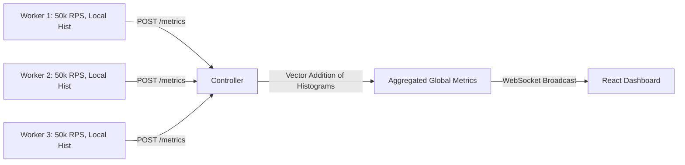

# LoadForge Complete Architecture Guide

LoadForge is a distributed, high-performance HTTP load-testing platform designed for extreme throughput and precise latency measurement. By separating the computationally intensive workload generation from the orchestration and visualization layers, LoadForge achieves near-metal performance while maintaining a modern, user-friendly interface.

## 1. System Overview

At a high level, LoadForge consists of three primary components:

1. **The Worker Engine (C++17):** A lock-free, highly concurrent network client that generates HTTP traffic.
2. **The Controller (Node.js/TypeScript):** A centralized orchestrator that manages workers, aggregates distributed metrics, and provides an API.
3. **The Dashboard (React/TypeScript):** A real-time web interface for test configuration and live metric visualization.

## 2. Component Deep Dive: C++ Worker Engine

The worker engine is the heart of LoadForge. Written in C++17, it avoids garbage collection pauses that would otherwise skew latency percentiles.

### 2.1 Thread Architecture and the Event Loop

Instead of the one-thread-per-connection model (which suffers from catastrophic context-switching overhead at scale), LoadForge uses a fixed-size thread pool. 

- **Pool Sizing:** The number of worker threads typically matches the number of logical CPU cores on the host machine.
- **Multiplexing:** Each thread handles hundreds or thousands of non-blocking sockets using `poll()` (or `epoll` on Linux).

### 2.2 Token Bucket Rate Limiter

To enforce a specific Requests Per Second (RPS) limit smoothly, LoadForge implements a thread-safe Token Bucket.

- Tokens are added based on elapsed time: `tokens += (elapsed_us * RPS) / 1,000,000`.
- A `std::atomic<double>` ensures that multiple threads can consume tokens without acquiring a lock. A compare-and-swap (CAS) loop prevents race conditions.

### 2.3 Logarithmic Histogram

Storing every single latency measurement for 10 million requests would exhaust memory and require expensive sorting to calculate percentiles (P90, P99). 

Instead, LoadForge uses a lock-free Logarithmic Histogram:
- The latency space (e.g., 1 microsecond to 60 seconds) is mapped to an array of buckets.
- High precision at the low end (1ms vs 2ms) and lower precision at the high end (10.1s vs 10.2s).
- Threads increment the bucket counters using `std::atomic::fetch_add(1, std::memory_order_relaxed)`.

## 3. Component Deep Dive: Node.js Controller

The Controller uses an event-driven, non-blocking I/O model (Node.js), making it perfectly suited for handling thousands of concurrent WebSocket connections and inbound metric flushes from workers.

### 3.1 Distributed Metric Aggregation

When a distributed test is running, each C++ worker flushes its local metrics (RPS, errors, histogram buckets) to the Controller every second.

To calculate the true global P99 latency, the Controller performs a vector addition of the histogram buckets from all workers, and then walks the merged histogram.

### 3.2 State Machine

The Controller maintains an in-memory state machine for active tests:
- `IDLE`: Waiting for commands.
- `STARTING`: Pinging workers to ensure health, distributing the target RPS among healthy workers.
- `RUNNING`: Accepting metric flushes, writing time-series data to Postgres.
- `STOPPING`: Broadcasting stop commands to workers.

## 4. Component Deep Dive: React Dashboard

The frontend is a React Single Page Application (SPA) providing absolute observability into the load test.

- **Vite:** Used for rapid bundling and hot-module replacement during development.
- **Recharts:** An SVG-based charting library used to render the RPS, Latency (P50, P95, P99), and Error Rate charts in real-time.
- **WebSocket Hooks:** Custom React hooks maintain the WebSocket connection, applying exponential backoff for reconnection if the Controller drops.

## 5. Network Protocol and Data Formats

### 5.1 Controller <-> Worker (HTTP/JSON)
We chose HTTP over gRPC for the initial version to simplify the C++ build process (avoiding Protobuf/gRPC dependencies).
- `POST /start`: `{"target": "http://api.example.com/v1/users", "rps": 10000, "duration_sec": 60}`
- `POST /flush`: `{"worker_id": "w1", "total_reqs": 10000, "histogram": [0, 5, 100, 9800, 95]}`

### 5.2 Controller <-> Dashboard (WebSocket)
The Controller pushes a merged metric payload every 1 second:
`{"type": "METRIC_TICK", "timestamp": 1690000000, "rps": 30000, "p99_latency_ms": 42.5}`

## 6. Deployment Architecture

LoadForge is deployed using Docker Compose, creating an isolated, reproducible environment.
- **Network Mode:** Workers should ideally be run on `network_mode: host` to bypass Docker's bridge network NAT, which introduces artificial latency and limits port exhaustion capabilities.
- **Kernel Tuning:** The host machine requires `sysctl` modifications:
  - `fs.file-max = 1000000`
  - `net.ipv4.ip_local_port_range = 1024 65535`
  - `net.ipv4.tcp_tw_reuse = 1`
